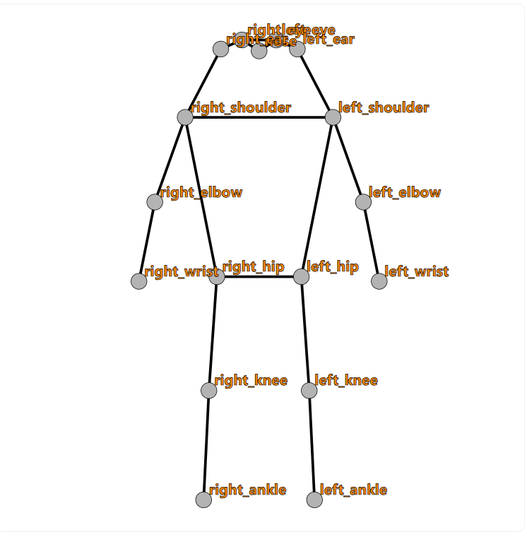
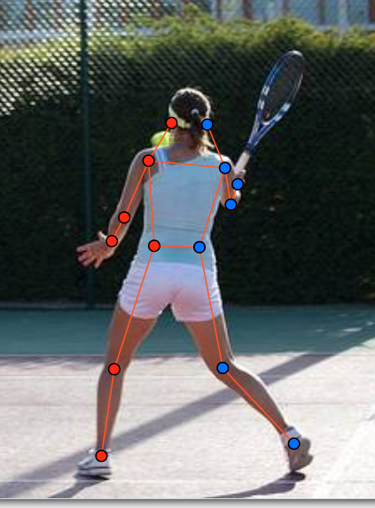
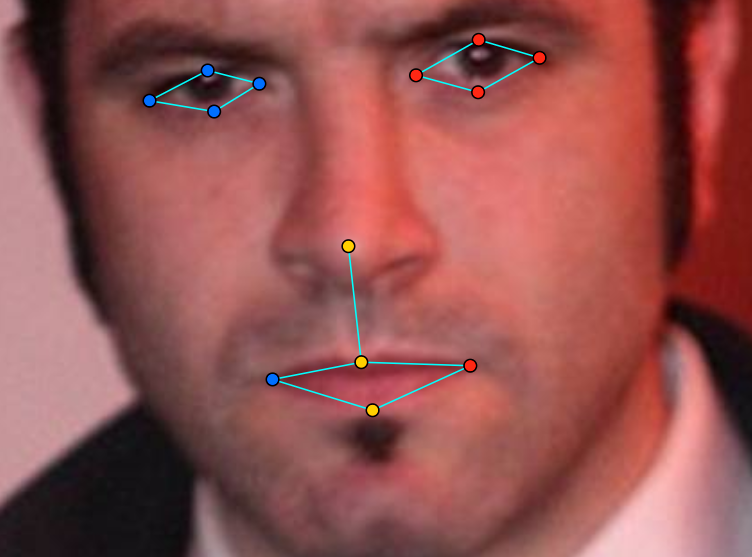
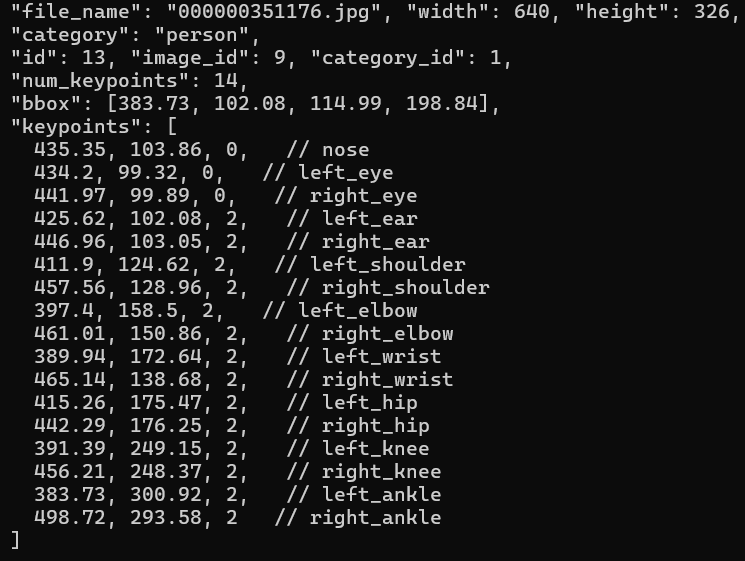

# Báo cáo cá nhân — HoVaTen-MSSV

Đổi tên file theo quy tắc `MSSV_HoTen.md`. Ví dụ: `20241234_NguyenVanAn.md`.

Dữ liệu: 12 ảnh người COCO val2017 (Lin et al., 2014) và 8 ảnh chân dung Wikimedia Commons, chỉ dùng trong lớp.

## 0. Thông tin học viên

- Họ tên: Nguyễn Văn Đại
- MSSV: 2A202604070
- Email: vdai20204@gmail.com
- Link repository: https://github.com/Pennywise111124/K5-L2B-NguyenVanDai-2A202604070-KeypointPose
- Phiên bản CVAT (Help → About): https://app.cvat.ai/
- Máy: dùng CVAT cloud (app.cvat.ai), không chạy CVAT local nên không có chế độ đầy đủ / lite
- Bộ ảnh (`src/exports/assignment.json` do `lab.py setup` tạo): có. File được tạo bằng prepare_cloud.py, script này gọi đúng hàm chia ảnh theo MSSV của lab.py, vì lab.py setup chỉ chạy với CVAT local
- Giờ bắt đầu: 17h00
- Giờ kết thúc: 18h33

## 1. Kiểm tra label (CP0)

| Label | Kiểu | Số điểm | Tên điểm đúng bảng của lab? | Đúng thứ tự? | Số cạnh |
|---|---|---:|---|---|---:|
| `person` | Skeleton | 17 | Có | Có | 19 |
| `face` | Skeleton | 13 | Có | Có  | 13 |

Mẫu `person` dựng theo người quay mặt về camera (các điểm `left_*` nằm bên phải khung mẫu)? Có

Cách đổi cờ `occluded` / `outside` cho **một điểm** trên phiên bản CVAT này (một câu):
- Rê chuột vào đúng điểm đó rồi bấm Q để đặt occluded hoặc O để đặt outside, bấm lại để tắt; chỉ điểm đang rê chuột bị đổi.

...

## 2. Số lượng đã gán và thời gian (CP1, CP2)

| Nhóm ảnh | Số ảnh | Số skeleton đã gán | Số người dưới 60 px (không gán) | Số poster / gương / màn hình bỏ qua | Thời gian (phút) |
|---|---:|---:|---:|---:|---:|
| `easy` | 5 | 5 | 0 | 1 | ~12 |
| `occluded` | 3 | 6 | 1 | 0 | ~10 |
| `back` | 2 | 4 | 2 | 0 | ~8 |
| `small` | 1 | 1 | 3 | 0 | ~4 |
| `crowd` | 1 | 3 | 2 | 0 | ~6 |
| `faces` | 8 | 8 | — | 0 | 20 |

- Số ảnh người đã xong ở mốc phút 105: 10 / 10
- Thời gian thực tế (phút): CP1 40 · CP2 20 · CP3 35
- Ảnh tốn thời gian nhất là ảnh nào, vì sao?
- Theo từng giai đoạn: CP1 tốn nhiều thời gian nhất (40 phút) vì mỗi người có 17 điểm, phải kiểm kỹ trái/phải và cờ, và số ca khó nhiều hơn. CP2 ngắn nhất (20 phút) vì mặt chỉ có 13 điểm và một skeleton mỗi ảnh. CP3 mất 35 phút vì ngoài rà lại 8 ảnh, tôi còn phải sửa lỗi tìm thấy: xóa skeleton thừa, gán thêm người bị bỏ sót và đặt lại cờ cho người bóng đen.

...

## 3. Bảng ca khó (CP1, CP2)

Mỗi điểm bạn phân vân một dòng, nhất là phân vân giữa `v = 1` và `v = 0`, hoặc không chắc hướng người.

| Ảnh | Người / mặt | Điểm | Cờ đã chọn | Phân vân giữa | Lý do chọn |
|---|---|---|---:|---|---|
| 000000030960 | 	cô dâu (bên phải ảnh) | right_hip | 1 | v = 0 hoặc v = 1 | Chỉ nhìn hình để dự đoán vị trí hông của cô dâu nên chưa chắc chắn lắm, nhưng từ dáng đứng vẫn hình dung ra được |
| 000000467300 | người đàn ông (bị cô dâu và bàn che) | left_knee, right_knee | 1 | v = 1 hoặc v = 0 | Từ dáng người vẫn suy luận được vị trí hai khớp gối |
| 000000043719 | người phụ nữ cầm ô (quay lưng) | left_hip, right_hip | 1 | v = 1 hoặc v = 2 | Đoán được hông ở đâu nhưng bị áo che khuất nên không chắc chắn lắm |
| 000000043719 | người đứng sau ô (gán thêm) | mũi, mắt, tai, left_elbow, left_wrist, hai cổ chân | 0 (đầu, left_elbow, left_wrist); 1 (hai cổ chân) | v = 0 hoặc v = 1 | Đầu nằm sau ô và tay trái bị che nên không thấy; cổ chân ở xa, mờ nhưng đoán được vị trí |
| 000000323705 | người bóng đen sau lan can | mặt, vai, khuỷu, cổ tay, hông, gối, cổ chân | 0 (mũi, mắt, tai, gối, cổ chân); 1 (vai, khuỷu, cổ tay, hông) | v = 0 hoặc v = 1; hướng người không rõ (quay mặt hay quay lưng) | Ảnh quá mờ và chỉ có bóng đen nên mặt không xác định được; phần thân trên vẫn thấy hình dáng nên đặt occluded theo ước lượng, chân bị lan can che nên đặt outside |
| face_514826 | mặt đeo kính trong | right_eye_outer, right_eye_inner | 2 | v = 1 hoặc v = 2 | Kính phản chiếu và bóng mũ, nhưng phóng to vẫn nhìn rõ được |
| face_415073 | mặt nghiêng | mouth_right | 1 | v = 1 hoặc v = 2 | Bị che nên không chắc chắn về vị trí khóe miệng phải |

## 4. Bảng tự review (CP3)

Đi từ ảnh cuối về ảnh đầu. 5 ảnh người (ít nhất 2 ảnh `back` hoặc `crowd`) và 3 ảnh mặt. Ít nhất 8 dòng, kể cả dòng `ok`. Ghi lỗi trước, sửa sau.

Mã lỗi dùng đúng một trong: `lr_swap`, `vis_flag`, `position`, `missing`, `extra`, `ok`.

| Ảnh | Người / mặt | Điểm | Mã lỗi | Ghi chú | Đã sửa? |
|---|---|---|---|---|---|
| 000000571665 | 2 người chơi game | toàn bộ | `ok` | `left_*` đúng phía theo hướng người, cờ `occluded` ở tai và mắt khớp với ảnh | - |
| 000000467300 | 2 người (cặp đôi cắt bánh) | toàn bộ | `ok` | thân dưới bị bàn che nên gối và cổ chân đặt `outside` / `occluded` | - |
| 000000351176 (back) | người chơi tennis quay lưng + trọng tài | toàn bộ | `ok` | người quay lưng có `left_*` ở bên trái ảnh, mũi và hai mắt đặt `outside` | - |
| 000000309169 (crowd) | người chạy ở bên trái ảnh | knee, ankle hai bên | `ok` | script cảnh báo hai cặp này nằm ngược phía; tôi đã xem lại: xác nhận đúng chân phải/trái, do người đang sải bước chạy | - |
| 000000043719 (back) | skeleton thứ 2 (khung 21×4 px trên thân xe bên trái) | cả skeleton | `extra` | không phải người, chỉ có 5 điểm dồn vào vài pixel. Do AI Asistance làm nhưng tôi chưa check kỹ | Đã xóa |
| 000000043719 (back) | người đứng sau ô (cao khoảng 90 px, phía phải ảnh) | cả người | `missing` | người thật cao hơn 60 px nhưng chưa được gán | Đã gán |
| 000000323705 (small) | người bóng đen sau lan can | nose, left_eye, right_eye, chân | `vis_flag` | 	bản xuất đầu có cả 17 điểm v = 2 dù là bóng đen không thấy mặt và chân bị lan can che | Đã sửa |
| face_560282 | mặt đội mũ, mắt liếc sang bên | 13 điểm | `ok` | trái/phải đúng, hai mí đặt giữa mắt dù con ngươi lệch | - |
| face_356144 | mặt nghiêng | 13 điểm | `ok` | `left_eye_*` ở bên phải ảnh; ria che môi trên nên `lip_upper` là ước lượng | - |
| face_146049 | mặt đeo kính râm | 8 điểm mắt | `ok` | cả 8 điểm mắt đã đặt `occluded` (`v = 1`) theo gọng kính | - |

Tổng hợp số lỗi theo mã:

| `lr_swap` | `vis_flag` | `position` | `missing` | `extra` | `ok` |
|---:|---:|---:|---:|---:|---:|
| 0 | 1 | 0 | 1 | 1 | 7 |

Điểm còn phân vân giữa `v = 1` và `v = 0` (ghi cả hai lựa chọn và lý do chọn):
- 000000030960, cô dâu, `right_hip`: chọn `v = 1`, phân vân `v = 0`. Chỉ nhìn hình để dự đoán vị trí hông nên chưa chắc chắn lắm, nhưng từ dáng đứng vẫn hình dung ra được vị trí.
- 000000467300, người đàn ông, `left_knee` và `right_knee`: chọn `v = 1`, phân vân `v = 0`. Từ dáng người vẫn suy luận được vị trí hai khớp gối dù bị cô dâu và bàn che.
- 000000323705, người bóng đen, vai / khuỷu / cổ tay / hông: chọn `v = 1`, phân vân `v = 0`. Chỉ thấy hình dáng bóng đen, vị trí các khớp là ước lượng theo dáng người.

## 5. Kiểm file xuất và kết quả tự kiểm (CP4)

Tự kiểm tay trong file JSON:

| File | Người / mặt kiểm (ảnh, thứ tự) | Số phần tử `keypoints` | Điểm `outside` ra `v = 0`, `occluded` ra `v = 1`? | `num_keypoints` khớp? |
|---|---|---:|---|---|
| `NguyenVanDai_persons.zip` | 000000351176.jpg, người quay lưng | 51 | Có: `nose`, `left_eye`, `right_eye` ra v = 0 | Có (14 = số điểm `v > 0`) |
| `NguyenVanDai_persons.zip` | 000000043719.jpg, người đứng sau ô (gán thêm) | 51 | Có: mũi, mắt, tai, `left_elbow`, `left_wrist` ra `v = 0`; hai cổ chân ra `v = 1` | Có (10) |
| `NguyenVanDai_faces.zip` | face_146049.jpg | 39 | Có: 8 điểm mắt ra `v = 1` | Có (13) |

Sau khi xuất, CVAT ghi `occluded` thành `v = 1` và `outside` thành `v = 0`. Tọa độ của điểm `outside` trong file là `0, 0` hay tọa độ cũ? Tọa độ cũ: cả 58 điểm `v = 0` của file persons đều giữ tọa độ ban đầu, không điểm nào là `0, 0` (ví dụ nose của người quay lưng ở 000000351176 là 435.35, 103.86).

Hai job đã chuyển sang completed trên CVAT? Có

Dán phần **TÓM TẮT** in ra từ `src/check_submission.py`:

```
- File person: NguyenVanDai_persons.zip
  Số ảnh: 12 · số skeleton `person`: 19 · mỗi annotation 51 số
  Skeleton theo ảnh: 000000030960=2, 000000043719=2, 000000103970=1, 000000156069=1, 000000201702=1, 000000294329=1, 000000309169=3, 000000323705=1, 000000351176=2, 000000467300=2, 000000558066=1, 000000571665=2
  Cờ v: v=2 225 (70%) · v=1 40 (12%) · v=0 58 (18%)
  num_keypoints trung bình: 13.9
- File face: NguyenVanDai_faces.zip
  Số ảnh: 8 · số skeleton `face`: 8 · mỗi annotation 39 số
  Skeleton theo ảnh: face_146049=1, face_147624=1, face_356144=1, face_362568=1, face_415073=1, face_469647=1, face_514826=1, face_560282=1
  Cờ v: v=2 94 (90%) · v=1 10 (10%) · v=0 0 (0%)
  num_keypoints trung bình: 13.0
- Ghi chú: 58 điểm v = 0 vẫn mang tọa độ cũ (CVAT 2.x xuất như vậy; chuẩn COCO ghi 0, 0). Không phải lỗi: điểm v = 0 bị bỏ qua khi huấn luyện và khi chấm.
- Số [LỖI]: 0 · số [CẢNH BÁO]: 2
Kết quả: ĐẠT (đọc lại từng cảnh báo ở trên)
```

Các `[CẢNH BÁO]` còn giữ nguyên và lý do:
- `000000309169.jpg #1` (cặp knee, ankle nằm ngược phía so với các cặp còn lại): giữ nguyên. Đây là người chạy ở bên trái ảnh, đang sải bước nên hai chân dạng ra hai phía; tôi đã đối chiếu lại với ảnh và xác nhận chân phải/trái đúng, không phải `lr_swap`.
- `000000323705.jpg #1` (các điểm chỉ trải cao 28 px, dưới 60 px): giữ nguyên. Người bóng đen này cao khoảng 86 px, nhưng đầu (mặt không thấy) và chân (bị lan can che) đều đặt `v = 0`, nên các điểm `v > 0` chỉ trải từ vai đến hông (28 px). Người không bị cắt khung, nên bỏ qua cảnh báo này.

...

## 6. Ảnh chụp màn hình

1. Label `person` trong label constructor (đủ 17 điểm có tên):

   

2. Một người quay lưng đã gán, cờ đã đặt:

   

3. Một khuôn mặt đã gán 13 điểm, phóng to vùng mắt:

   

4. Một đoạn JSON xuất của một người:

   

Nguồn ảnh: COCO val2017 / Wikimedia Commons.

## 7. Tự đánh giá

1. Lỗi bạn mắc nhiều nhất hôm nay, và cách bạn sẽ tránh ở dự án thật:
- 000000323705.jpg #1 (các điểm chỉ trải cao 28 px, dưới 60 px): giữ nguyên. Người bóng đen này cao khoảng 86 px, nhưng đầu (mặt không thấy) và chân (bị lan can che) đều đặt v = 0, nên các điểm v > 0 chỉ trải từ vai đến hông (28 px). Người không bị cắt khung, nên bỏ qua cảnh báo này.
   ...

2. Một quy tắc bạn đề xuất thêm vào guideline (kèm ảnh ví dụ nếu có):
- Với người chỉ là bóng đen hoặc hướng quay không rõ, mặc định mũi, mắt, tai là outside, phần thân nhìn thấy hình dáng thì đặt occluded thay vì bỏ cả người, và ghi hướng người vào bảng ca khó; đồng thời thêm một bước bắt buộc kiểm lại mọi skeleton do công cụ tự gán có khung bao nhỏ bất thường. Ví dụ: 000000323705 và 000000043719.
   ...

3. Nhãn của bạn đi vào model ở đâu? Chọn một lỗi bạn đã sửa và nói nó sẽ làm model học sai thế nào (heatmap, trọng số trong loss, hay bước lật ảnh):
- Lỗi đã sửa: người bóng đen ở 000000323705 để mũi và mắt v = 2. Nếu không sửa, v = 2 có trọng số đầy đủ trong loss nên model bị ép tạo heatmap sắc nét ở chỗ ảnh không có thông tin, dễ học đoán bừa. Ngoài ra, ở bước lật ảnh khi huấn luyện, hướng người không rõ làm cặp left_* và right_* có thể bị hoán đổi sai. Sau khi sửa, mặt đặt v = 0 nên bị bỏ khỏi loss, còn thân trên v = 1 vẫn được dùng như tín hiệu yếu.
   ...

## 8. Khó khăn và lỗi kỹ thuật
- Đề bài dùng CVAT cài ở máy và lab.py, còn tôi làm trên CVAT cloud https://app.cvat.ai nên không chạy được lab.py check, setup và export. Tôi thay bằng: prepare_cloud.py để chọn ảnh theo MSSV và ghi assignment.json, tạo project/task bằng tay (label dán từ src/lab/labels_d04_keypoint.json), ghép 17 điểm của model "Human pose estimation" với 17 điểm của label person bằng tay trong AI Assistance, export COCO Keypoints 1.0 bằng tay rồi chạy src/check_submission.py.

AI Assistance cho bản nháp nhanh nhưng tạo ra một skeleton thừa ở 000000043719 và để hầu hết điểm v = 2, nên bước tự review là bắt buộc. Model cũng không có khuôn mặt 13 điểm nên 8 ảnh mặt phải gán tay.
...

## 9. Tài liệu tham khảo và công cụ AI đã dùng
- CVAT (https://app.cvat.ai), công cụ AI Assistance → Auto-labeling, model "Human pose estimation", dùng để tạo bản nháp skeleton person cho các ảnh người; sau đó tôi tự kiểm và sửa trái/phải, vị trí điểm và cờ visibility.
- Claude (Anthropic): dùng để đọc và tóm tắt tài liệu của đề, hướng dẫn quy trình làm bài trên CVAT cloud, viết prepare_cloud.py.
...
